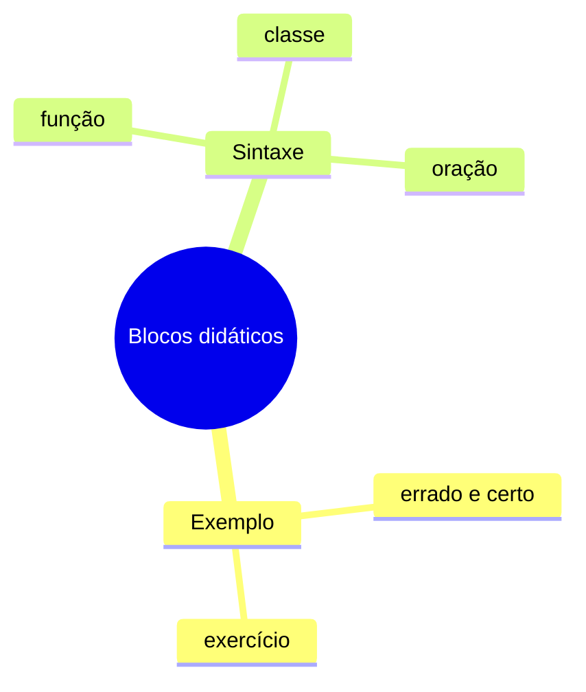

# Aula de teste - blocos didáticos

Aula para testar os blocos `exemplo` e `sintaxe`. Copie para `Acervo/Aulas/` do vault e abra na visão de aula. Em cada bloco, confira o que está escrito em **Confira**.

## Objetivos

- Ver os blocos `exemplo` e `sintaxe` desenhados na aula e no editor ao vivo.
- Testar o menu `/`, os botões e as camadas.

## Habilidades

- EF69LP55
- EF89LP37

## Conteúdo

### 1. Exemplo: errado, certo e porquê

Confira: dois cartões; `forão` com sublinhado ondulado vermelho e `foram` com sublinhado verde; linha "porquê" em cinza.

```exemplo
errado: Eles [forão]{erro} ao mercado.
certo: Eles [foram]{ok} ao mercado.
porquê: "Foram" é o pretérito perfeito de "ir".

errado: [Fazem]{erro} dois anos que moro aqui.
certo: [Faz]{ok} dois anos que moro aqui.
regra: Verbo "fazer" indicando tempo é impessoal.
```

### 2. Exemplo só com o errado

Confira: cada item com a frase e "Resposta:" com linha; o certo e o porquê não aparecem.

```exemplo exercicio
errado: Vou [à]{erro} pé até a escola.
certo: Vou a pé até a escola.

errado: Cheguei [a]{erro} uma hora da tarde.
certo: Cheguei à uma hora da tarde.
```

### 3. Sintaxe com uma camada

Confira: sujeito e predicado com rótulo sob o trecho; "o livro" e "na biblioteca" aninhados dentro do predicado.

```sintaxe
[Os alunos]{sujeito} [[leram]{verbo} [o livro]{objeto direto} [na biblioteca]{adjunto adverbial}]{predicado}.
```

### 4. Sintaxe com três camadas

Confira: caixas Função, Classe de palavra e Oração; desligar uma faz sumir só os rótulos dela; traços diferentes (cheio, pontilhado, duplo).

```sintaxe
[[[Os]{:artigo} [alunos]{:substantivo}]{sujeito} [[chegaram]{:verbo} cedo]{predicado}]{#principal}, [quando o sinal tocou]{#subordinada adverbial}.
```

### 5. Sintaxe como exercício

Confira: só a frase numerada e "Análise:" com linha.

```sintaxe exercicio
[Maria]{sujeito} [comprou]{verbo} [pão]{objeto direto}.
[As crianças]{sujeito} [brincavam]{verbo} [no parque]{adjunto adverbial}.
```

### 6. Casos de borda

Confira: o bloco abaixo aparece como código comum (idioma desconhecido) e o sem rótulo mantém os colchetes como texto.

```js
const x = "isto não é bloco didático";
```

```sintaxe
Colchete [sem rótulo] fica como texto, e [este]{sujeito} tem rótulo.
```

### 7. Botões

Confira: ao passar o mouse sobre um bloco aparecem "Copiar como imagem" (cola num editor de imagens) e, na sintaxe, "Pedir ao Claude" (copia um pedido de análise).

### 8. Menu `/`

Em uma linha vazia abaixo, digite `/ex`, `/sin`, `/erros`: o menu oferece inserir bloco de exemplo, de sintaxe e "erros comuns da turma".

## Mindmap



## Atividades

- Corrija a frase do bloco 2 e confira com o gabarito (altere o bloco para ver o certo).
- Analise as frases do bloco 5.

> [!margem] Teste
> Esta anotação deve aparecer na coluna "Na margem".
