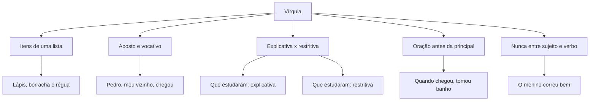

## Conteúdo

> [!abstract] Por que estas duas frases têm sentidos diferentes?
> Os alunos que estudaram passaram na prova.
> Os alunos, que estudaram muito este bimestre, passaram na prova.

### O que é?

A **vírgula** marca uma pausa curta dentro da frase. Ela serve para três coisas principais: separar itens de uma lista, isolar uma informação extra (que poderia ser cortada sem prejudicar o sentido) e marcar quem está sendo chamado. Ela nunca separa partes que formam um bloco só, como o sujeito e o verbo.

### Separar itens de uma lista

Quando os itens estão ligados por vírgula, o último costuma vir com *e*, *ou* ou *nem*, sem vírgula antes dessa conjunção.

> [!example] Exemplos:
> Marina comprou **lápis, borracha, caderno e régua**. (sem vírgula antes de "e", porque ele aparece só uma vez)
> **Ou ele estuda, ou ele repete, ou** desiste do curso. (a conjunção repetida também recebe vírgula antes)

### Isolar aposto e vocativo

O **aposto** explica ou detalha um termo; o **vocativo** chama alguém. Os dois vêm isolados por vírgula.

> [!example] Exemplos:
> **Pedro, meu vizinho,** emprestou a bicicleta. (aposto: explica quem é Pedro)
> **Rafael,** venha almoçar! (vocativo: chama o Rafael)

### Oração explicativa x oração restritiva

Uma oração **restritiva** limita o sentido do termo anterior e não leva vírgula. Uma oração **explicativa** só acrescenta um comentário e vem sempre entre vírgulas.

> [!example] Exemplos:
> Os alunos **que estudaram** passaram na prova. (restritiva: só os que estudaram passaram)
> Os alunos, **que estudaram muito este bimestre,** passaram na prova. (explicativa: todos passaram; a informação é extra)

### Quando a oração vem antes da principal

Se a oração menor aparece antes da principal, ela costuma vir seguida de vírgula.

> [!example] Exemplos:
> **Quando chegou em casa,** Beatriz tomou banho.
> Beatriz tomou banho quando chegou em casa. (ordem direta: sem vírgula)

### Onde a vírgula nunca aparece

> [!warning] Atenção
> O menino, correu para a escola. (Errado)
> O menino correu para a escola. (Certo)
> Ela gosta, de música clássica. (Errado)
> Ela gosta de música clássica. (Certo)

## Esquema

## Atividades

### Rápidas

#### 1. Complete com a vírgula

a) Comprei caderno lápis borracha e apontador. [Comprei caderno, lápis, borracha e apontador.]
b) Ana venha cá um instante. [Ana, venha cá um instante.]
c) O professor que chegou atrasado pediu desculpas. [duas leituras possíveis: sem vírgula = restritiva; com vírgula antes e depois de "que chegou atrasado" = explicativa]
d) Joana minha prima mora em Recife. [Joana, minha prima, mora em Recife.]

#### 2. Classifique o motivo da vírgula

a) "Lucas, meu colega de turma, faltou hoje." [aposto]
b) "Mariana, feche a janela, por favor." [vocativo]
c) "Comprei maçã, pera e uva." [itens de uma lista]
d) "Quando o sinal tocou, todos saíram." [oração antes da principal]

#### 3. Corrija a frase

a) O time, venceu o jogo. [O time venceu o jogo.]
b) Ela, comeu o bolo inteiro. [Ela comeu o bolo inteiro.]
c) Gosto, de filme de terror. [Gosto de filme de terror.]

### Longas

#### 4. Vírgulas no texto

*Objetivo: identificar e justificar o uso da vírgula em um texto curto. Tempo: 1 aula.*

Leia o texto e aponte o motivo de cada vírgula destacada.

"Lívia, minha irmã mais velha, chegou cedo. Quando entrou em casa, largou a mochila, tirou os sapatos e foi direto para a cozinha. — Lívia, tem comida guardada? — perguntei. Ela, cansada do treino, só balançou a cabeça."

a) "Lívia, minha irmã mais velha," [aposto]
b) "Quando entrou em casa," [oração antes da principal]
c) "largou a mochila, tirou os sapatos" [itens de uma lista de ações]
d) "Lívia, tem comida guardada?" [vocativo]
e) "Ela, cansada do treino," [aposto]

#### 5. Muda o sentido, muda a vírgula

*Objetivo: comparar o sentido de frases com e sem vírgula. Tempo: 1 aula.*

a) Compare: "Os jogadores que treinaram bem venceram." e "Os jogadores, que treinaram bem, venceram." Explique a diferença de sentido entre as duas. [Na primeira, só quem treinou bem venceu; na segunda, todos os jogadores treinaram bem e todos venceram.]
b) Escreva uma frase em que a oração com "que" seja restritiva (sem vírgula).
c) Escreva a mesma frase transformando a oração em explicativa (com vírgula) e explique o que muda.
d) Compare: "Minha mãe, que é médica, trabalha à noite." e "As pessoas que trabalham à noite dormem de dia." Por que uma tem vírgula e a outra não? [A primeira é explicativa: há só uma mãe, a informação é extra; a segunda é restritiva: "que trabalham à noite" limita quais pessoas.]

> [!tip] Dica para o professor:
> **6º e 7º ano:** trabalhe só os itens a e b, com frases bem simples. **8º e 9º ano:** aplique todos os itens e peça que expliquem a diferença de sentido com as próprias palavras.

#### 6. Reescreva e justifique

*Objetivo: transformar frases mudando a posição da oração e justificar o uso da vírgula. Tempo: 1 aula.*

a) "Carlos foi ao médico quando sentiu dor." Reescreva colocando a oração "quando sentiu dor" no início. [Quando sentiu dor, Carlos foi ao médico.]
b) Junte estas frases usando aposto: "Bruno é meu melhor amigo. Bruno mora ao lado." [Bruno, meu melhor amigo, mora ao lado.]
c) Transforme em lista com vírgulas: "Comprei arroz. Comprei feijão. Comprei óleo. Comprei sal." [Comprei arroz, feijão, óleo e sal.]
d) Reescreva corrigindo o erro: "O aluno, entregou a prova antes do tempo." [O aluno entregou a prova antes do tempo.]

### Escrita criativa

#### 7. Lista de compras impossível

Escreva um bilhete pedindo para alguém comprar itens estranhos ou engraçados no mercado. Use uma lista de pelo menos cinco itens separados por vírgula, terminando com "e" antes do último.

#### 8. Notícia inventada

Escreva uma notícia curta e bem-humorada sobre um acontecimento absurdo na escola. Use pelo menos dois apostos (explicando quem são as pessoas envolvidas) separados por vírgula.

#### 9. Diálogo maluco

Escreva um diálogo entre dois colegas em uma situação engraçada. Cada fala deve começar chamando o outro pelo nome, usando vocativo com vírgula.

### Lúdicas

#### 10. Vírgula ou não?

*Organização: duplas. Tempo: 15 minutos. Material: papel e lápis.*

1. Cada dupla recebe 5 frases escritas no caderno, algumas certas e outras com vírgula no lugar errado.
2. Os alunos decidem juntos quais estão certas e corrigem as erradas.
3. Ao final, cada dupla lê uma frase corrigida para a turma.

Frases sugeridas:
a) "O cachorro, latiu a noite toda." [errada: tirar a vírgula]
b) "Júlia, minha amiga, viajou ontem." [certa]
c) "Ele comprou pão, leite e ovos." [certa]
d) "A prova, foi difícil demais." [errada: tirar a vírgula]

#### 11. Caça-vírgula no quadro

*Organização: grupos de 4. Tempo: 20 minutos. Material: quadro e giz.*

1. O professor escreve no quadro um parágrafo curto sem nenhuma vírgula.
2. Cada grupo, na vez dele, vai ao quadro e insere uma vírgula que falta, explicando o motivo em voz alta.
3. A turma confere junto com o professor se a vírgula e a explicação estão certas.
4. O jogo termina quando todas as vírgulas necessárias tiverem sido encontradas.

#### 12. Vírgula viva

*Organização: turma toda. Tempo: 15 minutos. Material: nenhum.*

1. O professor lê frases em voz alta, uma de cada vez, sem dizer onde está a pausa.
2. Combinada a turma, todos batem palma no lugar em que acham que deve haver vírgula.
3. Depois de cada frase, o professor escreve no quadro e confirma se a palma caiu no lugar certo.

Frases sugeridas:
a) "Marcos meu colega de turma faltou hoje." [Marcos, meu colega de turma, faltou hoje.]
b) "Quando a aula acabou todos saíram correndo." [Quando a aula acabou, todos saíram correndo.]
c) "Comprei caderno lápis e borracha." [Comprei caderno, lápis e borracha.]
d) "Ana venha até aqui." [Ana, venha até aqui.]
